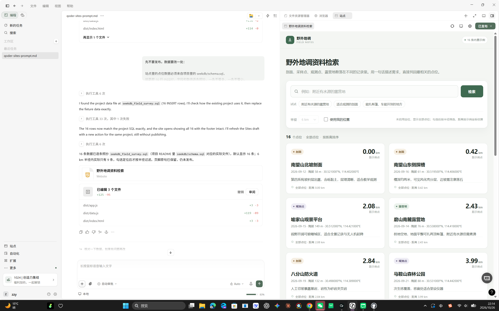

# Qoder 开发与发布记录

本文件记录线上站点的构建与发布标识，来源为 Qoder Sites 本地元数据
（`.野外地调资料检索.qoder.site`，只保留标识字段，不含任何凭证）。

## 一、发布标识

| 字段 | 值 |
|---|---|
| 站点名称 | 野外地调资料检索 |
| 线上地址 | <https://field-survey-search-88ks6uknvo5.qoder.website> |
| **Qoder 账号 UID** | **`01a17383-1d13-7793-9df9-dbc233d1b6ab`** |
| siteId | `01a1783c-761a-7c45-b295-06325b16d732` |
| projectId | `01a1783c-7618-7473-a351-db68687246a1` |
| deploymentId | `01a17844-122f-71ed-9438-9d0824a12a89` |
| actionId | `d5558b55-46c4-4a63-9fae-8bf4c1aab7f6` |
| releaseId | `01a1787f-d527-7726-b21c-0d50144d8fc3` |
| artifactSha256 | `c38e7e90067481a9a763cde4f23323fa1e1459e1f058c66fe105e7dba39343dd` |
| 元数据版本 | 1 |

## 二、开发时间线（本机文件时间为准）

| 时间 | 动作 |
|---|---|
| 20:25 | 在 Qoder Sites 建立工程，按 `qoder-sites-prompt.md` 的指令生成首版 |
| 20:38 | 生成 `styles.css` |
| 20:48 | 生成 `dist/index.html`、`dist/data.js` |
| 20:50 | 生成 `dist/app.js`，本地预览通过 |
| 21:1x | 数据改为严格照抄 `seekdb/schema.sql` 的 16 条点位（原为自动编造的点位） |
| 21:56 | 发布站点，访问范围改为「任何人可访问」 |
| 21:57 | 外部匿名访问验证：HTTP 200 |

## 三、可核验的三件事

1. **构建产物一致**：仓库 `site-published/` 与线上站逐字节对应，
   对应 `artifactSha256 = c38e7e90067481a9a763cde4f23323fa1e1459e1f058c66fe105e7dba39343dd`
2. **公开可访问**：不带任何登录态直接请求站点根路径返回 200
3. **数据同源**：`site-published/data.js` 的 16 条与 `seekdb/schema.sql` 的 16 条 INSERT 逐条一致

## 四、说明

`site-published/` 是静态构建产物；真实的 seekdb 检索由 `backend/app.py` 提供，
需按 `README.md` 在本地启动（公网站点无法直连内网数据库）。

## 五、Qoder 会话截图

这一页可以核对「项目必须使用 Qoder 开发」。图里能看到四样东西：

1. **左侧**：给 Qoder 的建站指令，以及它的执行反馈
   （"The 16 rows now match the project SQL exactly… still without publishing"）
2. **中间**：Qoder 的文件编辑记录 —— `dist/app.js`、`dist/data.js`、`dist/index.html`
3. **右侧**：站点预览，16 个点位，距离按 6 km 半径计算
4. **右上角**：站点状态「已发布」

> 截图里 Qoder 提到的是 `seekdb_field_survey.sql`，那是该文件后来归位到
> `seekdb/schema.sql` 之前的旧名，内容一致。
